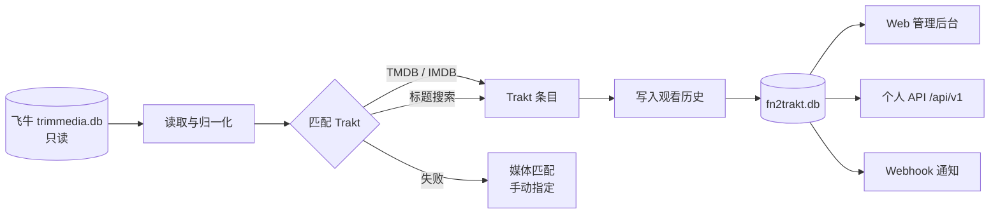

<p align="center">
  
</p>

<h1 align="center">FN2Trakt</h1>

<p align="center">
  把 <b>飞牛影视（fnOS / trimmedia）</b> 的观看记录，自动同步到 <b>Trakt</b>。
</p>

<p align="center">
  
  
  
  
  
</p>

> 非官方项目，与 Trakt、飞牛影视均无隶属关系。Trakt 是 Trakt, Inc. 的商标。

---

## 这是什么

FN2Trakt 是一个自托管的观影记录同步工具。

它只读打开飞牛影视的 SQLite 数据库，按 TMDB / IMDB ID 匹配 Trakt 条目，把已经看完的电影和剧集写入 Trakt 观看历史。自带中文管理后台，支持多用户、设备码授权、手动匹配、失败重试、Trakt 历史回填、个人 API 和 Webhook。

一句话：

> **在飞牛看完，Trakt 自动记上。**

### 为什么需要它

飞牛影视本身很好用，但观看记录只留在本地。Trakt 能跨设备记录观影历史，却不知道你在飞牛看了什么。

FN2Trakt 做的事情就是：

- 读取飞牛本地的观看进度
- 判断“是否看完”
- 找到对应的 Trakt 电影 / 剧集
- 写入 Trakt 观看历史
- 在本地保留一份可查询的记录和同步状态

整个过程中，**飞牛数据库始终只读**。

---

## 功能

| 功能 | 说明 |
| --- | --- |
| 🎬 飞牛观看记录 | 只读读取 `trimmedia.db`，自动解析电影 / 剧集 / 季 / 集 |
| 🔐 Trakt 设备码授权 | 生成 8 位授权码，在 `auth.trakt.tv/activate` 输入即可，无需回调地址 |
| 👥 多用户 | 管理员维护飞牛用户与 Trakt 绑定，普通用户各自授权 |
| 🧩 智能匹配 | 优先 TMDB / IMDB ID；缺失时按标题搜索；支持手动指定 |
| ✅ 看完判定 | `watched=1` 或播放进度达到阈值（默认 80%） |
| 🔁 定时增量同步 | 默认每 5 分钟扫描新完成的记录 |
| 🛠 手动同步 | 单条重试、批量预览、失败记录排查 |
| 📜 同步记录 | 每次上传的动作、时间、状态、错误原因 |
| 🌗 亮色 / 暗黑主题 | 中性灰背景、白色卡片、蓝色强调色 |
| 🔄 Trakt → 本地回填 | 拉取完整 Trakt 历史，更新已有记录，在库但无记录时补建 |
| 🔑 个人 API | 可分权限、可撤销的 Bearer Token，开放历史 / 统计 / 导出 / 媒体库接口 |
| 🪝 Webhook | 同步失败、未匹配、同步完成、回填完成；支持 HMAC-SHA256 签名 |
| 🐳 Docker | 多阶段构建，多架构镜像，数据与飞牛库全部通过 volume 挂载 |

---

## 工作方式



核心数据只有两个：

- **飞牛数据库**：只读，不写入
- **FN2Trakt 数据库**：保存用户、Trakt 绑定、同步记录、API Token、Webhook、Trakt 历史镜像

---

## 快速开始

推荐使用 Docker Compose。

### 方式一：Docker Compose 拉取预构建镜像（推荐）

镜像已经发布为多架构：

```text
spikeding/fn2trakt:3.0.0
├── linux/amd64
└── linux/arm64
```

新建目录：

```bash
mkdir -p fn2trakt
cd fn2trakt
```

把仓库里的 `docker-compose.yml` 和 `.env.docker.example` 放进来，然后：

```bash
cp .env.docker.example .env
```

编辑 `.env`，至少修改：

```dotenv
FN2TRAKT_IMAGE=spikeding/fn2trakt:3.0.0

# 宿主机端口
FN2TRAKT_HOST_PORT=8080

# 应用数据目录：fn2trakt.db、.secret_key、backups/
DATA_DIR=/your/path/fn2trakt/data

# 飞牛数据库所在目录（目录，不是单文件）
FNTV_DB_DIR=/your/path/trim.media/database
FNTV_DB_FILE=trimmedia.db

# NAS 上执行 id -u / id -g
PUID=1000
PGID=1000
```

启动：

```bash
docker compose pull
docker compose up -d
```

查看状态：

```bash
docker compose ps
docker compose logs -f
```

打开：

```text
http://<你的机器IP>:8080
```

首次访问会进入初始化向导。

> 如果 Docker Hub 仓库是私有的，先执行 `docker login`。

---

### 方式二：自己构建 Docker 镜像

适合修改源码、二次开发，或者不想依赖 Docker Hub。

```bash
git clone https://github.com/<your-name>/FN2Trakt.git
cd FN2Trakt
cp .env.docker.example .env
# 编辑 .env 里的路径和端口
```

构建：

```bash
docker build -t fn2trakt:3.0.0 .
```

使用源码构建的 Compose：

```bash
docker compose -f docker-compose.build.yml up -d --build
```

或者直接 `docker run`：

```bash
docker run -d \
  --name fn2trakt \
  --restart unless-stopped \
  -p 8080:8080 \
  -e TZ=Asia/Shanghai \
  -e PUID=$(id -u) \
  -e PGID=$(id -g) \
  -e FN2TRAKT_DATA_DIR=/data \
  -e FN2TRAKT_FNTV_DB_PATH=/fntv/trimmedia.db \
  -v /your/path/fn2trakt/data:/data \
  -v /your/path/trim.media/database:/fntv:ro \
  fn2trakt:3.0.0
```

构建双架构并推送（需要 Docker Hub 账号）：

```bash
docker buildx create --name fn2trakt-builder --driver docker-container --use
docker buildx inspect --bootstrap
docker run --privileged --rm tonistiigi/binfmt --install arm64

docker login

docker buildx build \
  --platform linux/amd64,linux/arm64 \
  -t <your-dockerhub>/fn2trakt:3.0.0 \
  -t <your-dockerhub>/fn2trakt:latest \
  --push .
```

---

### 方式三：源码运行

环境要求：

- Python **3.11+**（开发验证于 3.13）
- Node.js **18+**（只在修改前端时需要）
- 能访问 `api.trakt.tv` / `auth.trakt.tv`

安装：

```bash
git clone https://github.com/<your-name>/FN2Trakt.git
cd FN2Trakt

python3 -m venv backend/.venv
backend/.venv/bin/pip install -r backend/requirements.txt
cp .env.example .env

# 把飞牛数据库放到 DB/trimmedia.db，或修改 .env 里的路径
```

启动：

```bash
cd backend
.venv/bin/python -m uvicorn app.main:app --host 0.0.0.0 --port 8080
```

或者：

```bash
make install
make run
```

前端已经构建在 `backend/static`，不需要单独启动 Node。

修改前端后重新构建：

```bash
cd frontend
npm install
npm run build
```

---

## 首次配置

### 1. 创建管理员

打开首页，按初始化向导：

1. 确认飞牛数据库路径
2. 创建管理员账号
3. 绑定一个飞牛用户（之后可以在用户管理中修改）

### 2. 创建 Trakt 应用

打开：

```text
https://app.trakt.tv/settings/apps/api/new
```

按提示连接一个已验证的 GitHub 账号，创建一个 **Development** 应用。

新版 Trakt 应用通常只签发 **Client ID**，没有 Client Secret，这是正常的。设备码授权不需要 Secret。

### 3. 配置 Trakt 凭据

管理员进入：

```text
系统设置 → Trakt 应用凭据 → 新建凭据
```

填写名称和 Client ID，Client Secret 留空即可。

保存后，Client ID / Secret 不会再次回显。

### 4. 绑定 Trakt 账号

进入「Trakt 绑定」：

1. 选择当前站内用户
2. 点击生成授权码
3. 页面会显示 8 位 code
4. 在新标签页打开 `auth.trakt.tv/activate`
5. 输入 code 并批准
6. 回到 FN2Trakt，等待自动轮询完成绑定

### 5. 开始同步

进入「仪表盘」：

- 点击「立即同步」执行一次全量扫描
- 或等待定时任务（默认每 5 分钟）

只有满足以下条件的记录会被上传：

- 已看完（`watched=1` 或进度 ≥ 阈值）
- 能匹配到 Trakt 条目
- 还没有成功同步过

---

## 配置说明

### 环境变量

| 变量 | 默认 | 说明 |
| --- | --- | --- |
| `FN2TRAKT_DATA_DIR` | `/app/data` | 应用数据目录；Docker 中建议 `/data` |
| `FN2TRAKT_FNTV_DB_PATH` | `.../DB/trimmedia.db` | 飞牛数据库文件路径 |
| `FN2TRAKT_PORT` | `8080` | 容器内监听端口 |
| `FN2TRAKT_SECRET_KEY` | 自动生成 | 会话签名密钥；生产环境建议固定 |
| `FN2TRAKT_COOKIE_SECURE` | `false` | HTTPS 反代后设为 `true` |
| `FN2TRAKT_SESSION_DAYS` | `30` | 登录会话有效天数 |
| `FN2TRAKT_ADMIN_USERNAME` | 空 | 可选，首次启动自动创建管理员 |
| `FN2TRAKT_ADMIN_PASSWORD` | 空 | 与上项配合使用 |
| `FN2TRAKT_SYNC_ENABLED` | `true` | 是否启用定时同步 |
| `FN2TRAKT_SYNC_INTERVAL_MINUTES` | `5` | 同步间隔 |
| `FN2TRAKT_TRAKT_TRUST_ENV` | `true` | 是否读取系统 HTTP(S)_PROXY |
| `TZ` | `Asia/Shanghai` | 时区 |
| `PUID` / `PGID` | `1000` | 容器运行用户 |

Docker 部署时，**宿主机路径**通过 `.env` 控制：

| 变量 | 说明 |
| --- | --- |
| `DATA_DIR` | 宿主机上的应用数据目录 |
| `FNTV_DB_DIR` | 宿主机上的飞牛数据库目录 |
| `FNTV_DB_FILE` | 目录下的数据库文件名，默认 `trimmedia.db` |
| `FN2TRAKT_HOST_PORT` | 宿主机端口 |
| `FN2TRAKT_IMAGE` | 镜像标签 |

### Volume

```text
宿主机 DATA_DIR            -> 容器 /data        （读写）
宿主机 FNTV_DB_DIR         -> 容器 /fntv        （只读）
```

飞牛数据库是 WAL 模式，**必须挂载目录**，不要只挂 `trimmedia.db` 单个文件，否则 `-wal` / `-shm` 可能读不到。

### 数据文件

```text
DATA_DIR/
├── fn2trakt.db
├── .secret_key
└── backups/
    └── fn2trakt-YYYYMMDD-HHMMSS-before-backfill.db
```

备份这个目录即可完整备份 FN2Trakt。

---

## 使用指南

### 仪表盘

查看播放记录、已看完数量、已同步数量、电影 / 剧集统计、最近 30 天趋势和同步状态分布。

### 观看记录

列出飞牛播放记录，显示：

- 媒体标题
- 播放进度
- 匹配状态
- 同步状态
- 失败原因

支持筛选、搜索、单条重试。

### 媒体匹配

自动匹配失败时，可以手动选择 Trakt 条目。

匹配成功后，下一次同步会自动尝试上传。

### Trakt 回填

「开发者 → Trakt 回填」用于反向补齐本地记录。

1. 拉取 Trakt 历史到本地镜像
2. 预览匹配结果
3. 确认后自动备份 `fn2trakt.db`
4. 更新已有播放记录
5. 飞牛库有、但没有播放记录的条目会补建

**不会**修改飞牛数据库。

### 个人 API

在「开发者 → API Token」创建 Token：

```text
fnt_xxxxxxxxxxxxxxxxx
```

权限：

- `history:read`
- `library:read`
- `history:write`
- `sync:write`（仅管理员）

示例：

```bash
curl -H "Authorization: Bearer fnt_xxx" \
  "http://localhost:8080/api/v1/history?page=1&page_size=20"
```

主要接口：

```text
GET  /api/v1/health
GET  /api/v1/me
GET  /api/v1/history
GET  /api/v1/history/recent
GET  /api/v1/history/stats
GET  /api/v1/history/export?format=json|csv
GET  /api/v1/library
GET  /api/v1/sync/status
POST /api/v1/history/refresh
POST /api/v1/sync/run
```

完整 OpenAPI：`/docs`

### Webhook

在「开发者 → Webhook」添加端点。

事件：

| 事件 | 触发时机 |
| --- | --- |
| `sync.failed` | 同步失败或部分失败 |
| `sync.unmatched` | 存在未匹配 / 上传失败的记录 |
| `sync.completed` | 同步成功且有新上传 |
| `backfill.completed` | 回填完成 |

配置 Secret 后请求头会带：

```http
X-FN2Trakt-Signature: sha256=<HMAC-SHA256(raw_body, secret)>
```

失败每 5 分钟重试，最多 3 次。

---

## 项目结构

```text
FN2Trakt/
├── backend/
│   ├── app/
│   │   ├── api/            # FastAPI 路由
│   │   ├── db/             # SQLAlchemy 模型与会话
│   │   ├── fntv/           # 飞牛 SQLite 只读读取
│   │   ├── services/       # 匹配、同步、回填、Webhook、Token
│   │   ├── trakt/          # Trakt 客户端与设备码授权
│   │   └── main.py
│   ├── static/             # 构建好的前端
│   └── requirements.txt
├── frontend/               # Vue 3 + Element Plus + ECharts
├── docker/                 # 容器 entrypoint
├── docs/                   # 数据库结构与 API 文档
├── logo/                   # 品牌 Logo
├── scripts/                # 开发 / 启动脚本
├── Dockerfile
├── docker-compose.yml      # 拉取预构建镜像
├── docker-compose.build.yml# 源码构建
├── .env.example
├── .env.docker.example
├── Makefile
└── README.md
```

---

## 常见问题

### 飞牛数据库会被修改吗？

不会。FN2Trakt 以只读 URI 打开数据库：

```text
file:...?mode=ro
```

所有写操作只发生在 `fn2trakt.db`。

### 为什么必须挂载目录而不是单个 db 文件？

飞牛数据库是 WAL 模式，除了 `trimmedia.db` 还有：

```text
trimmedia.db-wal
trimmedia.db-shm
```

只挂单文件会丢失 WAL 中的最新数据。

### 容器报 `exec format error`

镜像架构不对。请使用多架构镜像，或在目标机器上重新构建：

```bash
docker build -t fn2trakt:3.0.0 .
```

### 端口被占用

修改 `.env`：

```dotenv
FN2TRAKT_HOST_PORT=18080
```

### 权限错误

让 `PUID` / `PGID` 与数据目录所有者一致：

```bash
id -u
id -g
```

### 同步失败 / Trakt 无法访问

确认容器能访问：

```text
api.trakt.tv
auth.trakt.tv
```

需要代理时，在 `.env` 设置 `FN2TRAKT_HTTPS_PROXY` / `FN2TRAKT_HTTP_PROXY`。

### 为什么只能单 worker？

定时任务和 Webhook 重试运行在 Web 进程内。

不要使用：

```bash
--workers 2
```

否则会重复执行同步任务。保持单进程即可。

---

## 安全建议

- 不要把 `DATA_DIR` 暴露到公网
- 不要把 `.env`、`fn2trakt.db`、`.secret_key` 提交到 Git
- 公网访问请放在 HTTPS 反向代理后，并设置 `FN2TRAKT_COOKIE_SECURE=true`
- Trakt Token 在本地 SQLite 中，请限制 `DATA_DIR` 权限
- API Token 只显示一次，丢失后重新创建

---

## 开发

```bash
make install       # 后端依赖
make install-web   # 前端依赖
make dev           # 开发模式
make build         # 构建前端
```

---

