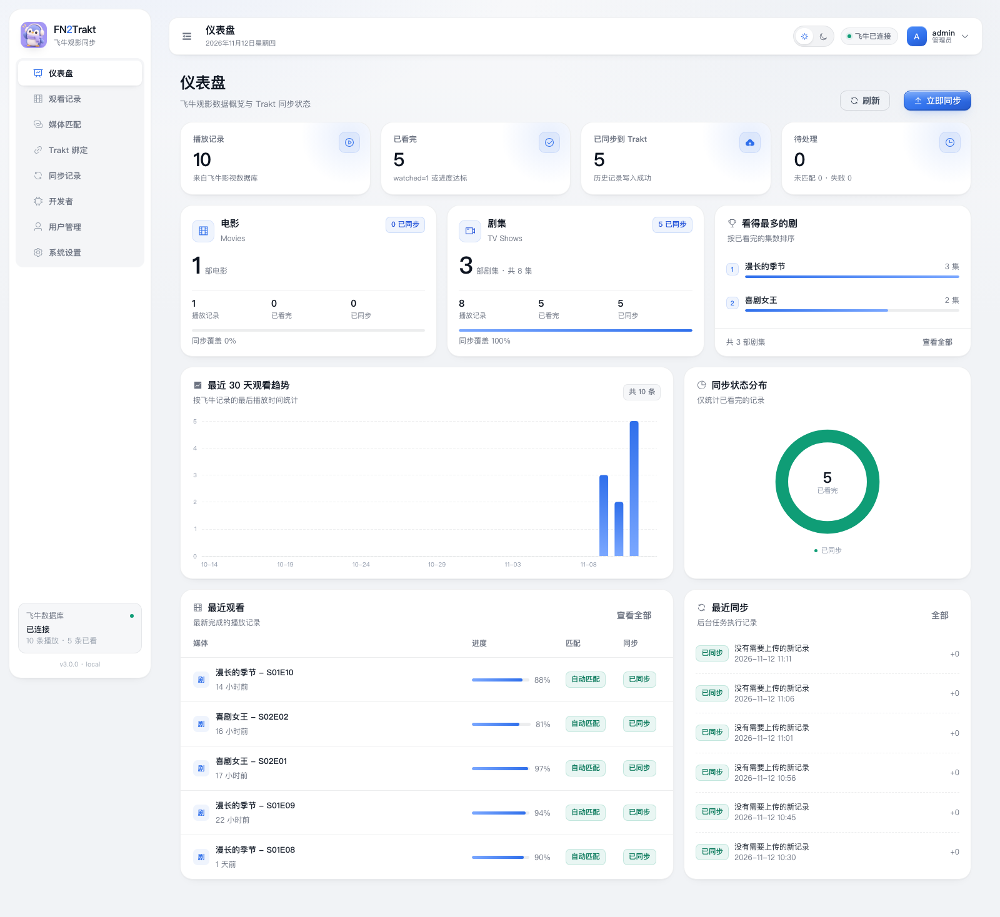
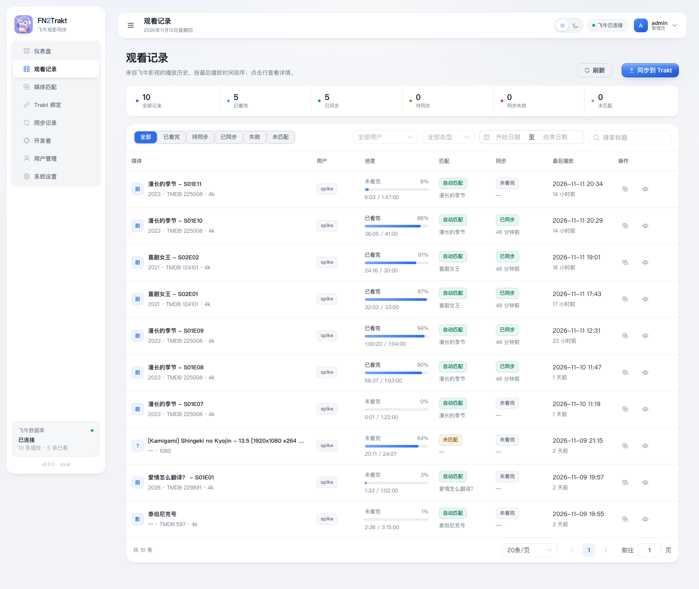
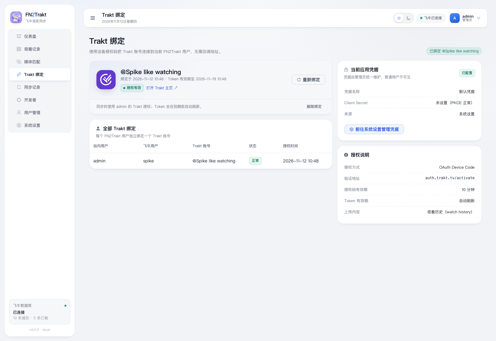
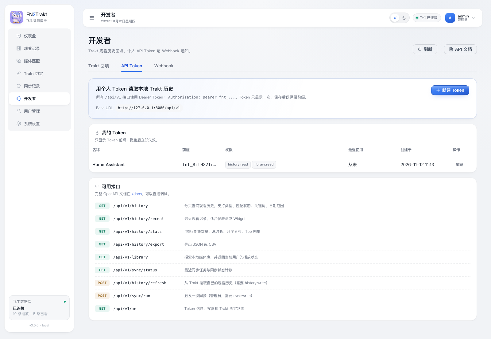
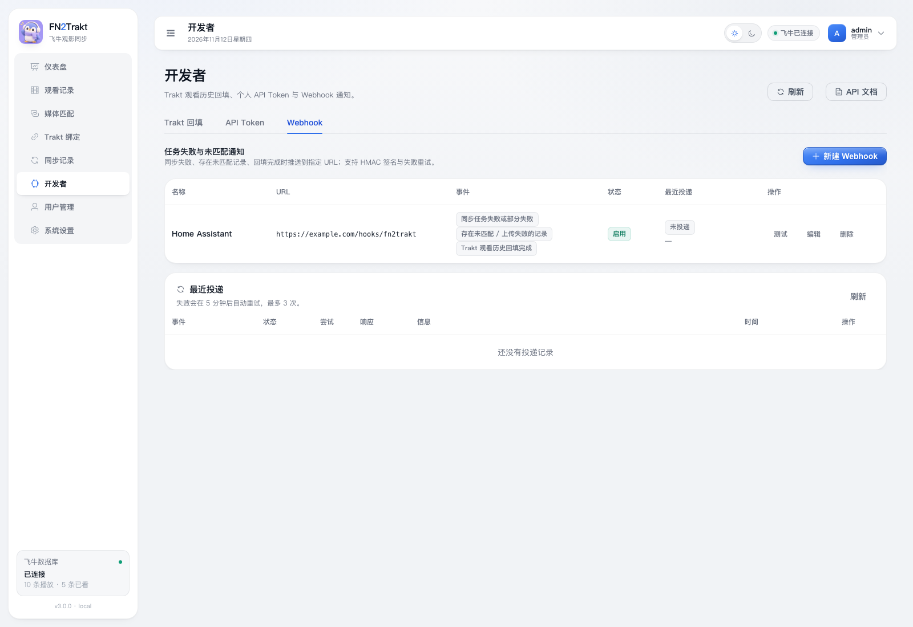
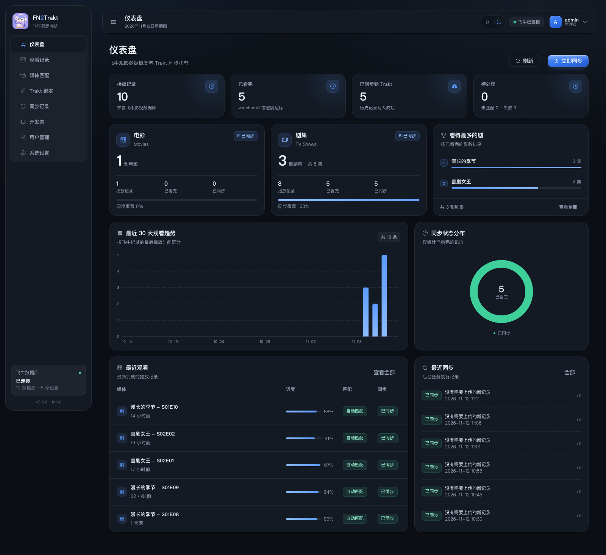

# FN2Trakt

把 **飞牛影视（fnOS / trimmedia）** 的观看记录自动同步到 **Trakt**。

读取飞牛本地 SQLite 数据库（常规只读；v4 可显式写入飞牛），按 TMDB / IMDB ID 匹配 Trakt 条目，通过官方 **OAuth Device Code** 授权，把已看完的电影 / 剧集写入 Trakt 观看历史。自带中文管理后台、多用户绑定、进度展示、失败重试与定时增量同步。

> 当前版本：`v4.1.4` · 更新记录见 [CHANGELOG.md](CHANGELOG.md)



## ✨ 功能

- **读取飞牛观影数据**：只读打开 `trimmedia.db`，自动构建 `Episode → Season → TV` 层级，识别电影 / 剧集。
- **Trakt 设备码绑定**：点击生成 8 位授权码 → 打开 `auth.trakt.tv/activate` → 输入并批准，自动轮询完成绑定。和 Emby Trakt 插件的体验一致。
- **多用户与角色**：管理员分配飞牛用户、维护 Trakt 应用凭据；普通用户只需完成自己的 Trakt 设备授权。
- **命名式应用凭据**：系统设置中可保存多套 Trakt 应用（名称 + Client ID + 可选 Secret），Client ID / Secret 保存后不在前端回显。
- **顺滑的授权体验**：验证码渲染完成后自动复制，顶部居中提示 5 秒倒计时，随后在**新标签页**打开 Trakt；原页面保持不动继续轮询。
- **亮色 / 暗黑双主题**：中性灰画布 + 纯白卡片 + 蓝色选中标记，按钮带液态玻璃质感，主题选择自动记忆。
- **历史批量 + 定时增量**：首次补齐历史；之后默认每 5 分钟自动读取飞牛数据库并上传新完成的记录（间隔可改），无需手动点「重新读取」。
- **智能匹配**：`tmdb_id` / `imdb_id` 优先；缺失时按标题搜索；仍失败可在「媒体匹配」中手动指定。
- **已看完判定**：飞牛 `watched=1` 或播放进度 ≥ 阈值（默认 80%，可调）。
- **可视化后台**：仪表盘趋势图、同步状态分布、电影 / 剧集数量、观看进度、匹配状态、上传记录、失败原因、单条重试；「观看记录」直接显示匹配到的影视名（未匹配显示 `-`）。
- **一键刷新并同步**：「观看记录」左上角的「刷新并同步」点击一次即完成读库 → 上传 → 刷新列表，不用再分别点刷新和同步。
- **本地 SQLite**：不依赖任何外部数据库；常规同步对飞牛数据库只读，v4 的「写入飞牛」是唯一例外。
- **Token 自动刷新**：Trakt access token 到期前自动用 refresh token 续期。
- **个人 API（v3）**：`/api/v1` 提供历史、统计、导出、媒体库、同步状态等只读接口；使用可分权限、可撤销的个人 Bearer Token。
- **Webhook 通知**：同步失败、出现未匹配媒体、写入飞牛完成时推送（时间统一为北京时间，`sent_at` 带 `+08:00`）；内置飞书 / 钉钉 / 企业微信机器人格式与签名，也支持自定义 JSON + HMAC-SHA256 签名、投递记录、失败重试和测试按钮。
- **Trakt → 飞牛数据库写入**：管理员可把 Trakt 历史写回飞牛 `item_user_play`，让飞牛 App 显示已看；只写匹配成功的条目，未匹配会列出并跳过，写入前自动备份、两步确认；已写过的记录自动跳过，写入进度可在「开发者 → 写入飞牛」查看。

| 观看记录 | Trakt 绑定 |
| --- | --- |
|  |  |

| 个人 API | Webhook |
| --- | --- |
|  |  |

## 🚀 快速开始（Docker Compose）

推荐用 Docker Compose 部署：一条命令起服务，**不需要 `.env`，不需要装 Python / Node**，配置全部写在 `docker-compose.yml` 里。

### 1. 准备 compose 文件

在 NAS 上建一个目录，把仓库根目录的 `docker-compose.yml` 放进去：

```bash
mkdir -p /vol1/docker/fn2trakt && cd /vol1/docker/fn2trakt
curl -O https://raw.githubusercontent.com/Senquan007/FN2Trakt/main/docker-compose.yml
```

（也可以直接从发布包或仓库根目录复制这个文件）

### 2. 改两处

打开 `docker-compose.yml`，只有两处需要按你的机器改：

```yaml
    ports:
      - "8213:8080"        # 宿主机端口；容器内固定 8080，可改成 8080 / 18080 等空闲端口
    volumes:
      - ./data:/data                                         # 应用 SQLite、密钥、备份
      - /usr/local/apps/@appdata/trim.media/database:/fntv    # 飞牛数据库目录，不要加 :ro
```

其余 `environment` 都是容器内路径与默认值，保持原样即可。

### 3. 启动

```bash
docker compose up -d
docker compose logs -f      # 看到 FN2Trakt started 后按 Ctrl+C 退出日志
```

镜像会自动从 Docker Hub 拉取 `spikeding/fn2trakt:4.1.4`（amd64 / arm64 都有）；网络不顺时先单独执行一次 `docker pull spikeding/fn2trakt:4.1.4`。

打开 `http://<NAS-IP>:8213`，进入初始化向导。

### 4. 初始化

首次访问会进入初始化向导：

1. 自动检测 `/fntv/trimmedia.db`（检测失败可在「系统设置」改路径）。
2. 创建管理员账号。
3. 选择要绑定的飞牛用户（例如 `yourname`）。
4. 管理员进入「系统设置 → Trakt 应用凭据」新建一套凭据；普通用户不需要配置。

### 5. 创建 Trakt 应用（新版只需要 Client ID）

Trakt 在 2026 年更新了应用体系：新应用默认使用 **PKCE**，**不再签发 Client Secret**。你看到的 “Client Secret: Not issued” 是正常现象，设备授权只用 Client ID 即可。

1. 打开 <https://app.trakt.tv/settings/apps/api/new>
2. 按提示连接一个已验证的 GitHub 账号（Trakt 新建应用的硬性要求）
3. 创建一个 **Development** 应用（个人 / 家庭使用足够，最多 16 人登录）
4. 复制 **Client ID**
5. 打开本服务「系统设置 → Trakt 应用凭据」，点击「新建凭据」
6. 填写凭据名称、Client ID，Client Secret 留空；如果应用表单要求填 **Redirect URI**，填同一个值
7. 保存后列表只显示名称、是否配置 Secret、Redirect URI 和使用情况，Client ID / Secret 不会再次回显
8. 多套凭据时，可把其中一套设为「默认」，设备授权会使用默认凭据

> - 设备授权本身不会发生浏览器回调，但 Trakt 在**刷新 Token** 时会校验 `redirect_uri`，所以两边必须一致。
> - 如果应用表单允许自定义，推荐填 `urn:ietf:wg:oauth:2.0:oob`（本服务默认值）。
> - 旧版 OAuth 应用仍可填写 Client Secret；新版应用留空即可。
> - 凭据保存在本地 SQLite；不会发送给除 Trakt 之外的任何服务。

### 6. 绑定 Trakt

1. 点击「生成 Trakt 授权码」
2. 验证码出现后自动复制，页面顶部居中弹出小提示：**「已自动复制授权码，5s 后在新标签页打开 Trakt」**
3. 5 秒倒计时结束，在**新标签页**打开 Trakt 授权页；FN2Trakt 原页面保持不动，继续轮询授权结果
4. 在 <https://auth.trakt.tv/activate> 输入授权码 → Continue → Approve
5. 回到原页面即可看到自动绑定成功（无需手动刷新）

> 浏览器通常会拦截「定时器到点才 window.open」的弹窗。为保证能自动打开新标签页，验证码就绪后会先创建一个「正在准备 Trakt 授权页」的新标签页，5 秒后把该标签页导航到 Trakt；FN2Trakt 页面始终保留。

### 7. 读取数据并同步

1. 打开「观看记录」，点左上角 **刷新并同步**：一次点击即读取飞牛数据库、上传新完成的记录、刷新列表
2. 或者等定时任务（默认每 5 分钟自动读库 + 上传，无需手动操作）
3. 「观看记录」确认已看完 / 匹配状态；未匹配的条目可在「媒体匹配」手动指定
4. 「同步记录」查看每次结果与失败原因

> 只读场景不需要任何写权限；如果要用「写入飞牛」，需要额外给数据库写权限，见[飞牛数据库权限与 Docker 挂载](docs/fntv-permissions.md)。

## 🐳 Docker 运维

| 要做的事 | 命令 |
| --- | --- |
| 改端口 / 挂载 | 改 `docker-compose.yml` 后执行 `docker compose up -d --force-recreate`（`restart` 不会改变挂载） |
| 更新版本 | 改 `image:` 标签后执行 `docker compose pull && docker compose up -d` |
| 查看日志 | `docker compose logs -f` |
| 停止 / 卸载 | `docker compose down`（宿主机 `./data` 不受影响） |

- 容器内端口固定 `8080`，只能改冒号左边的宿主机端口
- `/data` 必须可写；`/fntv` 必须是**目录**（不是 `trimmedia.db` 单文件），且不要加 `:ro`
- 数据落在宿主机 `./data/fn2trakt.db`；写入飞牛 / 恢复的备份在 `./data/backups/`
- 想自己构建镜像：`docker compose -f docker-compose.build.yml up -d --build`，配置同样写在 compose 里，不用 `.env`

完整参数与排错见 [docs/docker.md](docs/docker.md)。

## 🧑‍💻 从源码运行（开发 / 调试）

需要 Python **3.11+**（开发验证于 3.13）；改前端还需要 Node.js **18+**。

```bash
python3 -m venv backend/.venv
backend/.venv/bin/pip install -r backend/requirements.txt

cd backend
.venv/bin/python -m uvicorn app.main:app --host 0.0.0.0 --port 8080
```

打开 <http://localhost:8080>。前端已构建在 `backend/static`，无需单独启动 Node。

也可以：

```bash
make install   # 创建 venv + 安装依赖
make run       # 启动 8080
```

> 源码运行同样不需要 `.env`：默认值即可启动，日常配置在「系统设置」里改；确需改默认值（数据目录、飞牛库路径）时用环境变量，或改 `backend/app/config.py` 的默认值。

## 🎨 UI 设计

设计方向：**中性灰画布 + 纯白卡片 + 蓝色选中标记 + 液态玻璃按钮**。

- 页面背景为中性灰，内容全部落在白色卡片上，不混用彩色底块
- 蓝色只用于选中图标、主操作、关键数字和图表，作为唯一强调色
- 侧边栏和顶栏是独立的白色圆角卡片，菜单选中项为白色药丸 + 蓝色图标
- 按钮采用 CSS 液态玻璃：多层渐变、顶部反光、四边内高光和轻阴影，参考 liquid-glass-react 的视觉
- 仪表盘按行对齐：统计行、电影/剧集/排行行、趋势行、明细行，每行卡片等高
- 电影、剧集直接显示“多少部”的大数字，并拆出播放 / 已看完 / 已同步
- 卡片统一 20px 圆角，轻边框 + 柔和阴影；不使用大面积毛玻璃和彩色光斑
- 主题切换在右上角，选择保存在 `localStorage`，首次访问跟随系统偏好
- 移动端重新排列表格与筛选器，避免横向溢出

| 亮色模式 | 暗黑模式 |
| --- | --- |
|  |  |

更完整的设计令牌说明见 [docs/ui-design.md](docs/ui-design.md)。

## 🔁 写入飞牛（Trakt → 飞牛数据库）

「开发者 → 写入飞牛」把 Trakt 观看历史写回飞牛 `item_user_play`，让飞牛 App 也显示为已看。这是 v4 唯一会修改飞牛数据库的功能，只对管理员开放。

### 操作流程

1. 点击「拉取 Trakt 历史」，把完整 Trakt 历史同步到本地镜像（含飞牛库没有的条目）。
2. 「匹配成功（将写入）」列出能匹配到飞牛媒体库的条目：已有播放记录的标记为「将更新」，在库但无记录标记为「将创建」。
3. 「无法匹配（将跳过）」列出不在飞牛库、或缺少可播放文件的条目及原因，写入时自动跳过。
4. 点击「开始写入飞牛」，两步确认：第一步核对写入 / 跳过数量，第二步最终确认。确认后自动备份飞牛数据库再写入。
5. 写入完成后可在同页快速恢复（只覆盖飞牛数据库，不回滚本地 FN2Trakt 数据）。

> 预览与写入之间如果数据发生变化（重新拉取、重新匹配），写入会被拒绝并提示重新预览，避免写入与预期不一致。
> 已写入过的记录默认跳过；需要重写时打开工具栏的「含已写入」再预览。

### 前置条件：数据库必须可写

与常规同步不同，写入飞牛需要容器对飞牛数据库有**写权限**：

- 主库 `trimmedia.db` 对 UID 1000 是 `rw`
- 数据库目录 `rwx`（WAL 需要创建 `-shm`）
- compose 里的 `/fntv` **不能加 `:ro`**

写入前先验证：

```bash
docker exec -u 1000 fn2trakt sh -c '
  cat /fntv/trimmedia.db >/dev/null && echo READ_OK
  touch /fntv/.write-test && rm /fntv/.write-test && echo WRITE_OK
'
```

必须同时看到 `READ_OK` 和 `WRITE_OK`，否则「开始写入飞牛」会返回 400（`detail` 会写明是不可写、读不到播放记录，还是飞牛用户不存在）。

操作说明见 [docs/fntv-writeback.md](docs/fntv-writeback.md)，权限排查见 [docs/fntv-permissions.md](docs/fntv-permissions.md)。

## 🔌 个人 API

在「开发者 → API Token」创建 Token（只显示一次），然后在请求头使用：

```http
Authorization: Bearer fnt_xxxxxxxxx
```

| Scope | 能力 |
| --- | --- |
| `history:read` | 历史、统计、导出 |
| `library:read` | 媒体库搜索与本地播放状态 |
| `history:write` | 拉取 / 刷新自己的 Trakt 历史 |
| `sync:write` | 触发同步（仅管理员） |

主要接口：

```text
GET  /api/v1/history
GET  /api/v1/history/recent
GET  /api/v1/history/stats
GET  /api/v1/history/export?format=json|csv
GET  /api/v1/library
GET  /api/v1/sync/status
POST /api/v1/history/refresh
POST /api/v1/sync/run
GET  /api/v1/me
```

完整说明与示例见 [docs/api-v1.md](docs/api-v1.md)，也可以直接打开 `/docs` 调试 OpenAPI。

## 🪝 Webhook

管理员在「开发者 → Webhook」添加端点，按事件订阅：

| 事件 | 触发时机 |
| --- | --- |
| `sync.failed` | 同步失败或部分失败 |
| `sync.unmatched` | 存在未匹配 / 上传失败的记录（同一批只提醒一次） |
| `sync.completed` | 同步成功且有新记录上传 |
| `backfill.completed` | 写入飞牛完成 |

支持四种类型（新建时会按 URL 自动识别，也可手动选择）：

| 类型 | 请求格式 | Secret 用途 |
| --- | --- | --- |
| 飞书自定义机器人 | `msg_type=text` + `content.text`，签名字段在请求体内 | 机器人「签名校验」密钥，正文附 `timestamp` / `sign`（HMAC-SHA256，Base64） |
| 钉钉自定义机器人 | `msgtype=markdown` | 加签密钥，URL 追加 `timestamp` / `sign` |
| 企业微信群机器人 | `msgtype=markdown` | 不需要 |
| 通用 JSON | FN2Trakt 原始事件 JSON | 附加 `X-FN2Trakt-Signature: sha256=<HMAC-SHA256(raw_body, secret)>` |

飞书报 `19021 sign match fail or timestamp is not within one hour` 表示签名不在请求体内或时间戳偏差超过 1 小时；v4.1.2 起已按官方算法生成，请确认服务器时间同步（NTP）。

失败每 5 分钟自动重试，最多 3 次；「最近投递」会显示平台返回的 `code` / `errcode` 错误。Webhook 使用直连（不读取系统代理），适合局域网 Home Assistant / ntfy 等接收端。

## 🧠 同步规则

| 项目 | 规则 |
| --- | --- |
| 纳入同步 | `watched=1`，或播放进度 ≥ 阈值（默认 80%） |
| 不上传 | 未看完、未匹配、已忽略、已成功同步过的记录 |
| 观看时间 | 飞牛 `item_user_play.update_time`（毫秒转 UTC） |
| 写入接口 | `POST /sync/history`，电影按批、剧集按「剧 + 季」聚合 |
| 去重 | 本地 `(play_id, trakt_account_id)` 唯一；成功记录不再重发 |
| 失败重试 | 失败 / 阻塞记录会在下次同步时重新尝试，也可手动重试 |
| 速率限制 | 所有 POST 至少间隔 1.05 秒，自动处理 Trakt 429 |
| Token | 到期前 12 小时自动刷新；刷新失败标记为需重新授权 |

> 飞牛每个「用户 + 媒体」只有一条播放记录，因此**重复观看同一集不会产生新的 Trakt 历史事件**。当前版本以「补齐历史」为目标；如需记录重看，需要额外的播放事件表。

## 👥 角色与多用户模型

```text
站内账号 (app_user)
   ├── 角色：admin / user
   ├── 绑定一个飞牛用户 (fn_user_guid)
   └── 授权一个 Trakt 账号 (trakt_account)
          └── 记录签发时使用的应用凭据 (credential_id)
```

| 能力 | 管理员 | 普通用户 |
| --- | --- | --- |
| 查看全部用户数据 | ✅ | 仅自己的 |
| 创建 / 禁用账号 | ✅ | ❌ |
| 分配 / 绑定飞牛用户 | ✅ | ❌ |
| 新增 / 编辑 Trakt 应用凭据 | ✅ | ❌（也看不到 Client ID / Secret） |
| 设备授权码绑定 Trakt | ✅ | ✅ |
| 媒体匹配、同步全部用户 | ✅ | ❌ |
| 创建个人 API Token | ✅ | ✅ |
| 写入飞牛 / Webhook | ✅ | ❌ |

- 管理员可在「用户管理」创建账号、绑定飞牛用户、重置密码、停用账号。
- 管理员默认看到全部用户的汇总数据；普通用户只看到自己飞牛用户的记录。
- 每套 Trakt 凭据会记录到使用它的 Trakt 账号上，刷新 Token 时优先使用原凭据。

## 🗂 项目结构

```text
FN2Trakt/
├── backend/
│   ├── app/
│   │   ├── api/            # FastAPI 路由（含 v1 个人 API、Token、Webhook、历史回填）
│   │   ├── db/             # SQLAlchemy 模型与会话
│   │   ├── fntv/           # 飞牛 SQLite 只读读取、层级解析、归一化
│   │   ├── services/       # 入库、匹配、同步、Trakt 历史镜像、Webhook、Token
│   │   ├── trakt/          # Trakt 客户端与设备码授权
│   │   ├── utils/          # 时间等工具
│   │   └── main.py
│   ├── static/             # Vue 构建产物（由后端直接托管）
│   ├── tests/              # 使用本地 mock Trakt 的集成测试
│   └── requirements.txt
├── frontend/               # Vue 3 + Element Plus + ECharts
│   ├── public/             # 运行时 Logo / favicon
│   └── src/
├── DB/                     # 放置 trimmedia.db（数据库文件不提交）
├── data/                   # 运行时 SQLite（fn2trakt.db）
├── logo/                   # 品牌 Logo 源文件（主 Logo、Trakt 标识）
├── docker/                 # 容器 entrypoint、镜像推送脚本
├── Dockerfile
├── docker-compose.yml      # 部署用（拉取镜像，推荐）
├── docker-compose.build.yml# 源码构建镜像
├── docs/                   # 数据库结构、API、截图
├── scripts/                # dev / run 脚本
└── Makefile
```

## 📦 发布物分类

```text
his/        历史版本（V1 / V2）
release/    正式发布包与 SHA-256
docker/     容器 entrypoint、多架构镜像推送脚本
test/       已测试的中间包（不对外分发）
```

正式发布包不包含个人数据库、运行数据、测试数据库和带个人观看记录的截图。

## ⚙️ 配置项

配置有两处来源，**不需要 `.env`**：

- **Docker 部署**：直接写在 `docker-compose.yml` 的 `environment` 里（见上面的文件）
- **日常使用**：「系统设置」页面，保存后立即生效，**优先级高于环境变量 / compose**

所有变量以 `FN2TRAKT_` 开头：

| 变量 | 默认值 | 说明 |
| --- | --- | --- |
| `FN2TRAKT_DATA_DIR` | `./data`（容器内 `/data`） | 应用数据目录（SQLite、密钥） |
| `FN2TRAKT_FNTV_DB_PATH` | `./DB/trimmedia.db`（容器内 `/fntv/trimmedia.db`） | 飞牛数据库路径 |
| `FN2TRAKT_SECRET_KEY` | 自动生成 | 会话签名密钥；多实例部署时必须固定 |
| `FN2TRAKT_SESSION_DAYS` | `30` | 登录会话天数 |
| `FN2TRAKT_COOKIE_SECURE` | `false` | HTTPS 部署时设为 `true` |
| `FN2TRAKT_ADMIN_USERNAME` | 空 | 可选：首次启动自动创建管理员 |
| `FN2TRAKT_ADMIN_PASSWORD` | 空 | 可选：配合上面使用 |
| `FN2TRAKT_TRAKT_CLIENT_ID` | 空 | 可选：环境变量兜底凭据（优先使用页面中的命名凭据） |
| `FN2TRAKT_TRAKT_CLIENT_SECRET` | 空 | 可选：仅旧版 OAuth 应用需要 |
| `FN2TRAKT_TRAKT_API_BASE` | `https://api.trakt.tv` | API 基址（测试 / 代理用） |
| `FN2TRAKT_TRAKT_AUTH_BASE` | `https://auth.trakt.tv` | OAuth 基址（设备码 / Token） |
| `FN2TRAKT_TRAKT_TRUST_ENV` | `true` | 是否使用系统 HTTP(S)_PROXY |
| `FN2TRAKT_SYNC_INTERVAL_MINUTES` | `5` | 默认同步间隔（页面可改） |
| `FN2TRAKT_SYNC_ENABLED` | `true` | 默认是否启用定时同步（页面可改） |
| `FN2TRAKT_HOST` / `FN2TRAKT_PORT` | `0.0.0.0` / `8080` | 监听地址，容器内固定 8080 |

> 中国大陆访问 Trakt 不稳定时：compose 里取消注释 `HTTPS_PROXY` / `HTTP_PROXY`，保持 `FN2TRAKT_TRAKT_TRUST_ENV: "true"`；源码运行则给进程设置同名环境变量。

## 🔌 API 概览

完整列表见 [docs/api.md](docs/api.md)。

- `POST /api/setup` · `POST /api/auth/login` · `GET /api/auth/me`
- `GET /api/fntv/status` · `POST /api/fntv/refresh`
- `GET/POST /api/trakt/credentials` · `PATCH/DELETE /api/trakt/credentials/{id}`
- `POST /api/trakt/device/start` · `GET /api/trakt/device/{id}` · `GET/DELETE /api/trakt/account`
- `GET /api/plays` · `POST /api/sync/play/{id}` · `GET /api/sync/preview` · `POST /api/sync/run`
- `GET /api/media/targets` · `POST /api/media/match` · `POST /api/media/reject`
- `GET /api/dashboard` · `GET /api/sync/runs` · `GET /api/sync/records`

## 🧪 测试

```bash
make test
# 或
backend/.venv/bin/pip install -r backend/requirements-dev.txt
cd backend && .venv/bin/python -m pytest tests -q
```

测试使用本地 mock Trakt 服务，不会访问真实 Trakt，也不会写入任何真实账号。覆盖：

- 飞牛数据读取与归一化
- 设备码生成 / 轮询 / 授权落库
- 单条上传与重复上传保护
- 完整同步任务
- Token 刷新
- 媒体搜索与设置保存

## ⚠️ 已知限制

- 飞牛同一用户对同一媒体只有一条播放记录，**重看不会重传**。
- 匹配依赖飞牛写入的 `tmdb_id` / `imdb_id`；缺失时按标题搜索，中文名可能需要手动匹配。
- 新版 Trakt 应用没有 Client Secret；如果以后 Trakt 调整 `redirect_uri` 校验规则，刷新 Token 失败时按提示重新授权即可。
- 页面保存的 Client ID / Secret 不会回显；忘记后只能重新输入或新建凭据，请自行备份 `data/fn2trakt.db`。
- Trakt 返回 `not_found` 时会在「同步记录」中标记失败，需要人工匹配后重试。
- 定时任务运行在 Web 进程内，**只能单 worker 运行**（不要 `--workers > 1`）。
- 不内置 HTTPS，公网访问请放在反向代理后，并设置 `FN2TRAKT_COOKIE_SECURE=true`。
- SQLite 中保存了 Trakt token 明文，请限制 `data/` 目录权限。

## 🩺 常见问题排查

**页面偶发 500，日志出现 `could not read full fnTV library: unable to open database file`**

说明读取完整飞牛媒体库时打不开数据库，基本都是挂载或权限问题（WAL 需要目录可写）：

```bash
docker inspect fn2trakt --format '{{range .Mounts}}{{println .Source .Destination .RW}}{{end}}'
```

`/fntv` 必须是 `... /fntv true`；若是 `false`，去掉 compose 里的 `:ro` 后 `docker compose up -d --force-recreate`（`restart` 不生效）。然后确认 UID 1000 能读能写：

```bash
docker exec -u 1000 fn2trakt sh -c '
  cat /fntv/trimmedia.db >/dev/null && echo READ_OK
  touch /fntv/.write-test && rm /fntv/.write-test && echo WRITE_OK
'
```

**「写入飞牛」返回 400**

先看接口返回的 `detail`：

```bash
curl -s -H "Cookie: fn2t_session=<你的 session>" \
  "http://<NAS-IP>:8213/api/fntv/writeback/preview?account_id=1"
```

常见原因：数据库不可写、无法读取飞牛播放记录、绑定的飞牛用户不存在。逐项排查见[飞牛数据库权限与 Docker 挂载](docs/fntv-permissions.md#6-写入飞牛报-400-怎么定位)。

**同步没有自动发生**：定时任务默认每 5 分钟读库 + 上传，可在「系统设置 → 同步策略」调整间隔；「观看记录 → 刷新并同步」可立即触发一次。

**飞牛 App 里看不到 Trakt 的记录**：Trakt → 飞牛是反向写入，需要在「开发者 → 写入飞牛」拉取历史并执行写入，且数据库必须具备写权限。

## 🐳 Docker 交付物

- `docker-compose.yml`：**推荐**，直接拉取 `spikeding/fn2trakt:4.1.4`，配置写在文件内，无 `.env`
- `docker-compose.build.yml`：源码构镜像（多阶段：Node 构建前端 → Python 运行 FastAPI）
- `Dockerfile` + `docker/entrypoint.sh`：镜像构建与容器启动
- `docker/push.sh`：把 amd64 / arm64 合并成多架构清单并推送到 Docker Hub
- 容器内端口固定 `8080`；compose 里 `/fntv` 以可写方式挂载以支持 v4 写入，普通同步仍以只读模式打开数据库
- 镜像不包含数据库、密钥或 Token

完整说明见 [docs/docker.md](docs/docker.md)。

## 📚 文档

- [飞牛数据库结构说明](docs/fntv-database.md)
- [飞牛数据库 SQL Schema](docs/fntv-schema.sql)
- [飞牛数据库权限与 Docker 挂载](docs/fntv-permissions.md)（读写权限、WAL、400 排查）
- [Trakt → 飞牛写入与恢复](docs/fntv-writeback.md)
- [Docker 部署](docs/docker.md)
- [HTTP API](docs/api.md) · [个人 API v1](docs/api-v1.md)
- [UI 设计说明](docs/ui-design.md)

## 📄 说明

常规同步只读取飞牛影视数据库；v4 的「写入飞牛」是唯一会修改飞牛数据库的功能，执行前必须备份并确认。请自行备份 `data/fn2trakt.db`；解除 Trakt 绑定不会删除已写入 Trakt 的历史。
